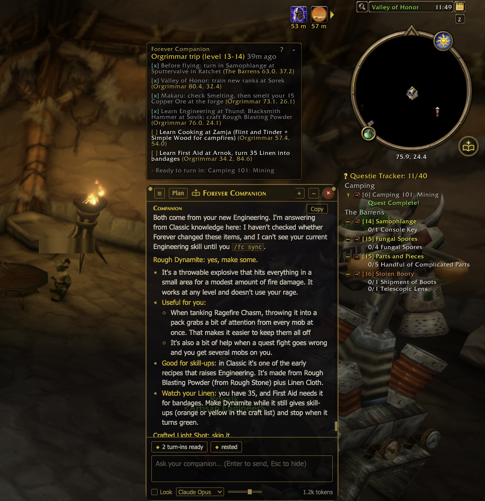

# Forever Companion

<p align="center">
  
</p>

<p align="center">
  <a href="https://github.com/biokraft/wow-forever-companion/actions/workflows/ci.yml"></a>
  <a href="https://github.com/biokraft/wow-forever-companion/releases"></a>
  <a href="LICENSE"></a>
  
</p>

Forever Companion is a free AI leveling helper for **WoW: Forever**. It reads the data its
addon saves about your character (level, gear, bags, talents, spells, professions, quest log) and your
installed Questie quest database, answers your questions in a small chat window over the game,
and shows its plan in a panel inside the game that ticks steps off as you play.
It sends no input to the game, reads no game memory and automates nothing.

<p align="center">
  
</p>

## Install

**macOS:** open Terminal and paste:

```bash
curl -fsSL https://raw.githubusercontent.com/biokraft/wow-forever-companion/main/install.sh | sh
```

**Windows (beta):** open PowerShell and paste:

```powershell
irm https://raw.githubusercontent.com/biokraft/wow-forever-companion/main/install.ps1 | iex
```

That one line does the whole install:

1. It checks for Node.js 22 or newer. If it is missing, it offers to install it (with
   Homebrew on macOS, with winget on Windows) or tells you where to download it.
2. It puts Forever Companion into the folder `wow-forever-companion` in your home folder.
3. It starts setup, which finds the game, asks which character is your main and where to
   keep your progress data, installs the addon and the chat overlay, and helps you sign in
   to an AI provider.

Setup asks only what it cannot find out by itself. Pasting the line again later is safe: it
updates what is there and skips every step that is already done.

What you need:

- **WoW: Forever** on macOS, or on Windows (beta). Windows (beta) means: the automated tests
  and the installer run on Windows machines in the cloud, but nobody has tried it on a real
  Windows PC yet, and live state (below) is macOS only. Please report what you find.
- **An AI login**: an OpenAI, Anthropic or Google Gemini API key, an OpenRouter account, or
  a ChatGPT account. AI providers require their users to be 18 or older. Using an AI
  provider may cost money; that is between you and the provider. The author plays with the
  Claude Code backend (see [docs/REFERENCE.md](docs/REFERENCE.md)); the default path
  through Pi is covered by the automated tests but gets less daily use, so reports are
  welcome.
- **About 250 MB** of disk space for the chat overlay.
- **[Questie](https://github.com/Questie/Questie)**, strongly recommended: the companion
  reads its quest database for quest givers, routes and coordinates.

<details>
<summary>Install by hand instead</summary>

With [Node.js](https://nodejs.org) 22 or newer and git installed:

```bash
git clone https://github.com/biokraft/wow-forever-companion.git
cd wow-forever-companion
node bin/wowf setup
```

On Windows, type `node bin\wowf setup`. Without git, click **Code**, then **Download ZIP**
on the [GitHub page](https://github.com/biokraft/wow-forever-companion), unpack it, open a
terminal in that folder and run the last line. [docs/SETUP.md](docs/SETUP.md) explains
every step and every question setup asks.

</details>

## Let your agent install it

If you use an AI coding agent (Claude Code, Codex, Pi or similar), paste this line into it:

> Clone https://github.com/biokraft/wow-forever-companion and follow docs/AGENT-INSTALL.md to set it up for me.

The agent asks you a few short questions, runs setup for you and tells you what to do in
the game. It never touches the game window and never handles your AI keys or logins:
for the AI login step it tells you to run `node bin/wowf setup` yourself.

## First steps in the game

1. Quit WoW fully and start it again (the game loads new addons only at start).
2. On the character screen, click **AddOns** and tick **Forever Companion**.
3. Log in and type `/fc sync`. This saves your character data for the companion.
4. Start the chat overlay: `node bin/wowf overlay` in the wow-forever-companion folder (on
   Windows: `node bin\wowf overlay`). Skip this if the overlay already starts at login.
5. Click the round **FC** button over the game, or press **Alt+Space**, and ask
   "what should I do next?". **Esc** closes the chat (on macOS it also hands the keyboard straight back to the game).

The first time you log in with the addon, an in-game guide opens. Reopen it any time with
the **?** on the plan panel or `/fc help`.

| In game | What it does |
|---|---|
| `/fc` | show or hide the plan panel |
| `/fc sync` | save your data for the companion and load its newest plan (reloads the UI) |
| `/fc status` | one-line status in chat |
| `/fc help` | open the in-game guide |
| `/fc bridge on\|off` | turn live state on or off (macOS, see below) |
| left-click a step | map pin at the step's location |
| right-click a step | tick it by hand |

The companion sees your data when the game saves it: on `/fc sync`, logout or quit. Put
`/fc sync` on an action-bar macro.

## What you can ask

- **What now?** The next quests to pick up and turn in, with NPC names and coordinates,
  grouped by area.
- **Upgrades:** "is the Ringed Vest an upgrade?" It compares your bags with your gear using
  your class's stat weights and weapon skills.
- **Talents, trainers, weapon skills, professions:** "which talent at 12?", "where do I train
  Engineering?", "what do I need for Mining 75?"
- **Plans in the game:** ask for a route and it puts the steps in the in-game panel. Steps
  tick themselves when you turn in the quest, reach the level, equip the item or learn the
  skill. Click a step for a map pin.
- **Look:** tick **look** in the chat to send a screenshot of the WoW window with your
  question.
- **Your game plan:** click **Plan** at the top of the chat. The first time, click
  **Start my game plan** and answer a few questions (what you enjoy, solo or with friends,
  fast or exploring, role and weapons, professions, what to skip, a first milestone). The
  companion keeps your goal, build, playstyle, professions and milestones on a card that
  folds in and out, and every answer follows it. To change it, say so on the Plan page or
  in any chat. From a terminal, ask "set up my game plan".
- **Quick answers:** when the companion asks something with a few likely answers, it shows
  them as chips above the input. Click one to answer, or tick several and click
  **Send these**. You can always type instead.

It does not give rotation advice or live combat calls (what to press, when to interrupt,
where to stand). It helps with leveling, quests, routes, gear, talents, professions and
preparation.

When it needs class or profession knowledge it does not have, it reads a short list of WoW
sites and saves dated notes with their sources in your data folder. Notes older than 14 days
are checked again. Answers come from an AI and can be wrong.

Tell it about yourself: your goals, build and professions go in your game plan; fill in
"About me" in the `AGENTS.md` file in your data folder (by default
`~/wow-companion/AGENTS.md`) with the rest, like who you play with, when you play and how
you like your answers.

## Update

```bash
node bin/wowf update
```

Run it in the wow-forever-companion folder (Windows: `node bin\wowf update`), or paste the
install line again. It gets the newest version, refreshes the overlay's packages when they
changed and copies the new addon into the game. Afterwards, type `/reload` in the game, and
if the overlay was running, run `node bin/wowf overlay` again to restart it.

In a folder made with git, update stops without changing anything if you edited files
there. In a folder made without git, it downloads the newest files and replaces the old
ones. Your settings and progress data live elsewhere and are kept either way.

Once a day the overlay and `wowf doctor` check whether a newer version is out and show one
line when it is. See [Privacy](#privacy) for what that check sends.

## Live state (macOS, optional, off by default)

With live state on and the overlay running, the companion sees your level, XP, rested XP,
money, position and quest progress as you play, without a `/fc sync`.

How it works: the addon draws a thin coded line of near-black pixels along the top edge of
the game window. The overlay takes a picture of the WoW window only, about every 10 seconds
(more often for a moment while it collects quest pages, and once before each question),
reads the line, deletes the picture at once and writes the values next to your character
data. The line is hidden while you are in combat.

**The risk:** an outside program reads a coded line that the addon draws. It never controls
the game. Blizzard has not approved or ruled on this technique; use it at your own risk.
That is why it is off unless you turn it on.

- **Turn it on:** `/fc bridge on`, or in the settings of the in-game guide. The first time,
  the addon prints a short note explaining what it does.
- **Turn it off:** `/fc bridge off`. Live data then ages out within two minutes.
- **Needs:** macOS, the overlay running, and *Screen Recording* permission for the overlay
  (the same permission **look** uses). Windows has no live state.
- **Still needs `/fc sync`:** gear, bags, loot, talents, skills and spells. A new plan needs a reload.

Live values are never written into your snapshot, journal or plans, and the live file is
never committed to your data folder's history.

## Privacy

Your data stays on your computer. Your data folder holds snapshots of your character,
history, plans and research notes (and, if you let the companion keep them, dated progress
notes in `knowledge/progress.md`).

What leaves your computer:

- **To your AI provider**, while it answers: your question, the data the companion reads to
  answer it, and a screenshot only when you tick **look**. Pi or Claude Code may keep these
  in their own session files on your computer.
- **To WoW sites**, when the companion researches: page requests to Warcraft Tavern,
  warcraft.wiki.gg, Blizzard's forums and news, Icy Veins and Method. With the default
  Pi backend, those requests name Forever Companion in their user agent, obey each site's
  robots.txt, wait a second between pages of one site, and are never retried when a site
  blocks them. With the `claude` backend (see [docs/REFERENCE.md](docs/REFERENCE.md)),
  Claude Code's own fetcher is used,
  limited to the same sites, and the companion may also run web searches through Claude
  Code. Sites whose terms do not allow automated access are not fetched; the companion gives
  you the link instead.
- **To GitHub**, when you install or update: the installer and `wowf update` download the
  project's files. The requests carry nothing about you.
- **To GitHub**, once a day: the update check asks GitHub's public API for the newest
  release. The request carries nothing about you. Set `"updateCheck": false` in the config
  to turn it off.
- **To GitHub**, only when you click **Report a problem**: a bug form opens in your browser,
  filled in with the version, your operating system and the backend. Nothing is sent until
  you submit the form yourself.

## Troubleshooting

Run this first:

```bash
node bin/wowf doctor
```

It checks Node, the config, the game folder, the addon, the data folder, your first sync,
the overlay and the AI login, and says what to run for anything that fails. It shows your
home folder as `~` and contains no character names, so you can paste it anywhere.

- **"No synced data"**: log in, type `/fc sync`, then run `node bin/wowf sync`.
- **The addon is missing in the AddOns list**: quit WoW fully and start it again.
- **Empty talents or skills**: check `diagnostics` in your character file in the data
  folder's `characters/` folder.
- **The overlay did not install, or its Electron app did not download**: run
  `node bin/wowf setup` again.
- **Quest lookups unavailable**: install Questie.
- **The game lost its mouse cursor**: click into WoW once. The overlay never takes focus by
  itself, only when you open it.

**Report a problem:** in the overlay, click **☰** and then **Report a problem** at the bottom
of the chat list. It opens a GitHub bug form in your browser, filled in with the version,
your operating system and the backend. Paste the `wowf doctor` output into it. You can also
open an issue directly on [GitHub](https://github.com/biokraft/wow-forever-companion/issues).

## More

- [docs/SETUP.md](docs/SETUP.md): the setup, step by step, with every question it asks.
- [docs/REFERENCE.md](docs/REFERENCE.md): the overlay in detail, the two AI backends, the
  config file, every `wowf` command, and using the companion from Pi or Claude Code in a
  terminal.
- [docs/ARCHITECTURE.md](docs/ARCHITECTURE.md): how the parts fit together.

## Credits and trademarks

Forever Companion is a fan-made tool. It is not affiliated with or endorsed by Blizzard
Entertainment.
World of Warcraft and Warcraft are trademarks or registered trademarks of Blizzard Entertainment, Inc.

Quest data comes from your own installed copy of [Questie](https://github.com/Questie/Questie).
Research notes cite their sources, such as [warcraft.wiki.gg](https://warcraft.wiki.gg).
The overlay is built with [Electron](https://www.electronjs.org) and talks to
[Pi](https://pi.dev) or Claude Code.

## License

[MIT](LICENSE)
